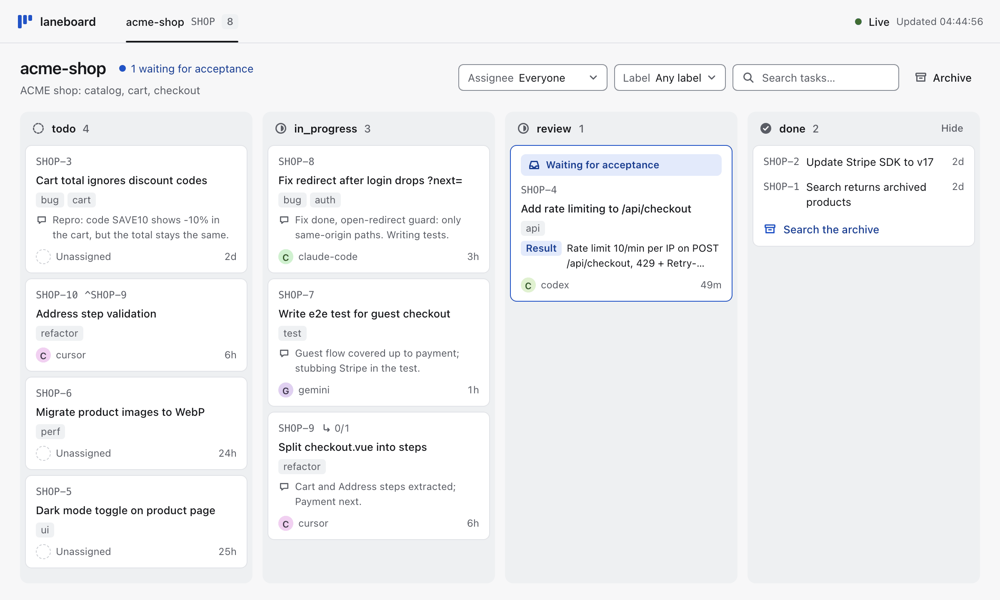
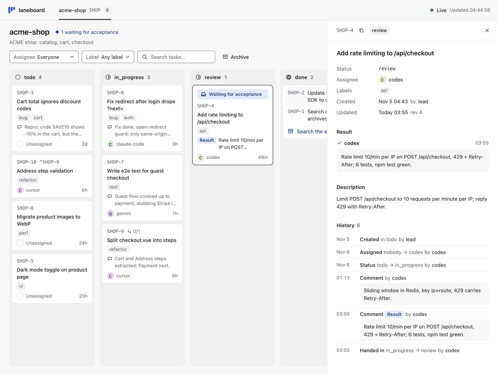
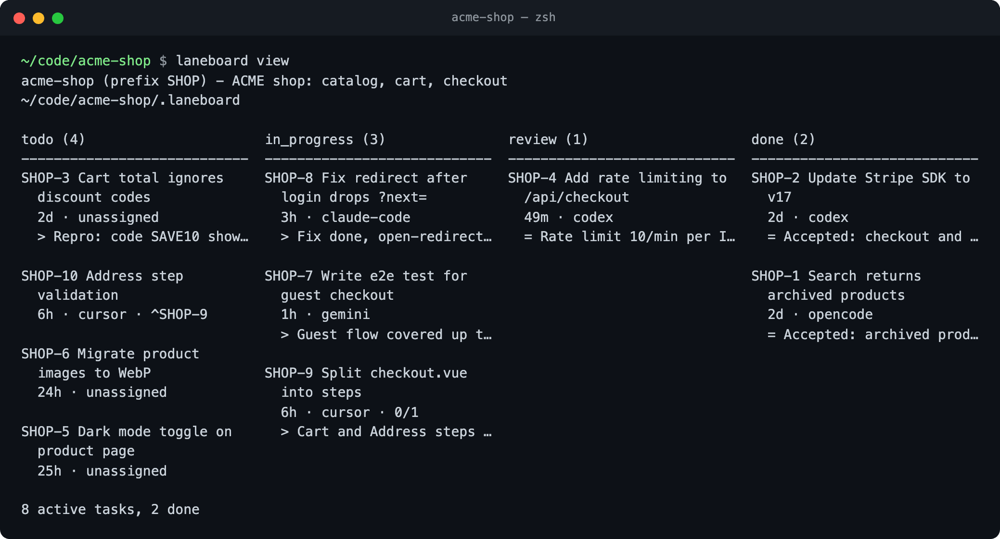
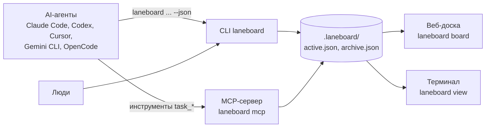

[English](https://github.com/bazarbayevabylay/laneboard/blob/main/README.md) | Русский

# laneboard

**Доска задач и CLI для AI-агентов.** Агенты сами заводят, берут, комментируют и закрывают свои задачи, а вы смотрите на доску вживую.

[](https://www.npmjs.com/package/laneboard) [](https://github.com/bazarbayevabylay/laneboard/blob/main/LICENSE) [](https://nodejs.org/)

<!-- guide:skip installs globally -->
```sh
npm i -g laneboard
```

<picture>
  <source media="(prefers-color-scheme: dark)" srcset="https://raw.githubusercontent.com/bazarbayevabylay/laneboard/main/docs/assets/board-dark.png">
  
</picture>

Работает с Claude Code, Codex, Cursor, Gemini CLI, OpenCode и любым другим MCP-клиентом.
Ни сервера, ни базы данных: доска — это два JSON-файла в папке проекта.

## Зачем laneboard

- **Агенты ведут доску сами.** `laneboard setup` даёт агенту правила и MCP-инструменты; в Claude Code хук печатает их
  в начале каждой сессии и напоминает агенту, если тот правит файлы без задачи.
- **Видно, кто чем занят.** По каждой задаче ясно, кто над ней работает, что с ней происходило и чем всё закончилось;
  доска в браузере показывает изменение через 1–2 с.
- **Несколько агентов не мешают друг другу.** Каждая запись берёт блокировку и атомарно заменяет файл; задачу, которую взял
  один агент, другой взять не сможет (`ALREADY_CLAIMED`).
- **Ошибка подсказывает агенту, что делать.** В каждой ошибке есть `fix` — готовая команда: выполнить как есть или поправить под себя.

`TODO.md` — просто текст: по нему не понять, кто над каким пунктом работает,
а два агента, правящие его одновременно, затирают друг друга.
Трекер задач живёт на сервере, за аккаунтом и сетью. laneboard лежит рядом с кодом и работает без интернета.

## Быстрый старт

1. Поставьте CLI, один раз на машину: `npm i -g laneboard` (Node.js 22 или новее, macOS или Linux).
2. В корне проекта создайте доску и подключите агента. Имя и описание в одну строку подскажут агентам, чья это доска.

```sh
laneboard init --name web --description "Интернет-магазин ACME: витрина и корзина"
laneboard setup claude-code
```

3. Откройте новую сессию агента в папке проекта: MCP-сервер и инструкции подгружаются при старте. Claude Code попросит
   одобрить MCP-сервер проекта `laneboard`, после этого `/mcp` покажет его. Проверьте доску из терминала:

```sh
laneboard prime
```

4. Дайте агенту любую задачу. Он заведёт её на доске, возьмёт в работу, будет комментировать шаги и закроет с итогом.

Другой агент? Возьмите его команду из раздела [Подключение агента](#подключение-агента). Подробнее об установке: [docs/install.md](https://github.com/bazarbayevabylay/laneboard/blob/main/docs/install.md) (на английском).

## Для AI-агентов

Вставьте это своему агенту (Claude Code, Codex, Cursor, Gemini CLI, OpenCode):

```text
Подключи laneboard к этому проекту по разделам 1 и 2 гайда
https://raw.githubusercontent.com/bazarbayevabylay/laneboard/main/docs/agent-guide.md
(поставь CLI, сделай `laneboard init` с именем и описанием этого проекта и `laneboard setup` для агента, которым ты являешься).
Потом выполни `laneboard prime`, веди эту и все следующие задачи на доске и скажи, если тебя нужно перезапустить.
```

[Гайд для агентов](https://github.com/bazarbayevabylay/laneboard/blob/main/docs/agent-guide.md) (на английском) — полное руководство
для агента: установка, цикл задачи, ошибки, настройка, импорт. Он есть и в npm-пакете: `$(npm root -g)/laneboard/docs/agent-guide.md`.

## Подключение агента

Одна команда в корне проекта. Она регистрирует MCP-сервер `laneboard`, добавляет блок инструкций из трёх строк и привязывает проект к его доске.

| Агент | Команда | Что она пишет |
|---|---|---|
| Claude Code | `laneboard setup claude-code` | `.mcp.json`, `CLAUDE.md`, хуки и привязку к доске в `.claude/` |
| Codex | `laneboard setup codex` | `~/.codex/config.toml` (глобальный: запускайте Codex в папке проекта), `AGENTS.md` |
| Cursor | `laneboard setup cursor` | `.cursor/mcp.json`, `AGENTS.md` |
| Gemini CLI | `laneboard setup gemini` | `.gemini/settings.json`, `GEMINI.md` |
| OpenCode | `laneboard setup opencode` | `opencode.json`, `AGENTS.md` |

В один проект можно подключить несколько агентов. Повторный запуск отвечает `unchanged`, `--dry-run` ничего не пишет, `--remove`
убирает только то, что записал setup. Все файлы и хуки, которые он трогает: [docs/configuration.md](https://github.com/bazarbayevabylay/laneboard/blob/main/docs/configuration.md).

```sh
laneboard setup codex
```

### Claude Code: плагин или setup

Вместо `setup claude-code` можно поставить плагин прямо из Claude Code: тот же MCP-сервер и те же хуки, плюс скилл с правилами агента.

```text
/plugin marketplace add bazarbayevabylay/laneboard
/plugin install laneboard@laneboard
```

Плагин не ставит CLI и не создаёт доску: сначала выполните `npm i -g laneboard` и `laneboard init`.
Выберите что-то одно — плагин или `setup claude-code`: оба регистрируют тот же сервер и те же хуки.

### Любой MCP-клиент

Подойдёт любой клиент, который запускает stdio MCP-серверы. Добавьте эту запись сервера в конфиг проекта, с доской и именем
по умолчанию (глобальный конфиг привязал бы к этой доске все проекты машины):

```json
{ "command": "laneboard", "args": ["mcp", "--dir", "/abs/path/to/project/.laneboard", "--as", "codex-1"] }
```

Первым агент вызывает `task_prime`: правила, статусы, поля, свои и свободные задачи. Проверить, что сервер запускается:

```sh
laneboard mcp --dir .laneboard --as codex-1 < /dev/null
```

## Что делает агент

Эти команды агент выполняет сам (или те же MCP-инструменты `task_*`). `dev-1` — имя агента: у сессий Claude Code есть
имя по умолчанию, остальные агенты передают `--as` ([docs/agent-names.md](https://github.com/bazarbayevabylay/laneboard/blob/main/docs/agent-names.md)).

```sh
laneboard create "Починить редирект после входа" --status todo --assignee dev-1 --as dev-1 --json
laneboard claim WEB-1 --status in_progress --as dev-1 --json
laneboard claim WEB-1 --as codex-1 --json  # exit 4
laneboard comment WEB-1 "Причина: редирект теряет query string" --as dev-1 --json
laneboard update WEB-1 --append-description "Шаги: войти со страницы /cart" --as dev-1 --json
laneboard finish WEB-1 --result "Исправлено, тест на редирект добавлен" --as dev-1 --json
laneboard list --scope all --json
```

В третьей строке второй агент пытается взять ту же задачу. Он получает ошибку с командой, которую нужно выполнить вместо этого (код выхода 4):

```json
{"ok": false, "store": "/path/to/my-app/.laneboard", "prefix": "WEB",
 "error": {"code": "ALREADY_CLAIMED",
  "message": "task WEB-1 is already claimed by dev-1; do not take it over: reassignment is the orchestrator's decision",
  "fix": "laneboard comment WEB-1 \"<note for dev-1>\" --as codex-1 --json", "details": {"assignee": "dev-1"}}}
```

`finish` записывает итог, привязывает текущий git-коммит и закрывает задачу. Подробнее: [docs/task-cycle.md](https://github.com/bazarbayevabylay/laneboard/blob/main/docs/task-cycle.md).

## Как смотреть доску

`laneboard board` в папке проекта печатает `http://127.0.0.1:7420/` и показывает доску до Ctrl+C. Она только для просмотра
и обновляется сама: задачи меняют агенты, CLI и MCP; каждая доска машины — отдельная вкладка. Клик по задаче открывает её поля и историю.

<picture>
  <source media="(prefers-color-scheme: dark)" srcset="https://raw.githubusercontent.com/bazarbayevabylay/laneboard/main/docs/assets/task-dark.png">
  
</picture>

`laneboard view` рисует ту же доску в терминале; `view --watch` перерисовывает её после каждой записи.

```sh
laneboard view
```



Порты, фильтры и HTTP API только для чтения: [docs/board-http-api.md](https://github.com/bazarbayevabylay/laneboard/blob/main/docs/board-http-api.md).

## Как это устроено



Всё лежит в `.laneboard/` проекта. Каждая запись берёт блокировку, читает свежие данные, проверяет их и атомарно заменяет файл,
поэтому много агентов пишут одновременно без потерь. `init` убирает папку из git, `laneboard doctor` её проверяет.

```sh
laneboard doctor
```

Резервные копии, удаление и вычистка секретов, импорт из `TODO.md` и других трекеров: [docs/storage.md](https://github.com/bazarbayevabylay/laneboard/blob/main/docs/storage.md).

## Ограничения

| Что | Почему |
|---|---|
| Только macOS и Linux | атомарный rename и блокировка проверены там; Windows нет в CI, npm отказывается ставить пакет (`EBADPLATFORM`) |
| Одна машина, локальные диски | блокировка — каталог в файловой системе: ни сетевых дисков, ни папок Dropbox или iCloud |
| До ~10 000 задач на доске | каждая команда читает файл целиком; старые задачи стоит архивировать |
| Путь доски этой машины в файлах проекта | его пишет `setup`; на другой машине запустите `setup` заново |
| Доска в браузере только для просмотра | задачи меняют агенты, CLI и MCP |

## Документация

Подробные документы — на английском.

| Что | Где |
|---|---|
| Гайд для агентов: установка, цикл задачи, ошибки, настройка, импорт | [docs/agent-guide.md](https://github.com/bazarbayevabylay/laneboard/blob/main/docs/agent-guide.md) |
| Установка из git, версии Node.js, обновление, удаление, перенос на другую машину | [docs/install.md](https://github.com/bazarbayevabylay/laneboard/blob/main/docs/install.md) |
| Что пишет setup, подробности MCP, префикс, статусы, поля, метки | [docs/configuration.md](https://github.com/bazarbayevabylay/laneboard/blob/main/docs/configuration.md) |
| Цикл задачи: создание, закрытие, подзадачи, git worktree | [docs/task-cycle.md](https://github.com/bazarbayevabylay/laneboard/blob/main/docs/task-cycle.md) |
| Имена агентов, сессии, `/clear` и продолжение работы | [docs/agent-names.md](https://github.com/bazarbayevabylay/laneboard/blob/main/docs/agent-names.md) |
| Оркестраторам: проверки в N шагов, проверяющие, авторы задач, передача задачи | [docs/orchestrators.md](https://github.com/bazarbayevabylay/laneboard/blob/main/docs/orchestrators.md) |
| Монорепозиторий и несколько досок | [docs/monorepo.md](https://github.com/bazarbayevabylay/laneboard/blob/main/docs/monorepo.md) |
| Доска в терминале и браузере, HTTP API | [docs/board-http-api.md](https://github.com/bazarbayevabylay/laneboard/blob/main/docs/board-http-api.md) |
| Хранилище, безопасность, удаление и redact, импорт | [docs/storage.md](https://github.com/bazarbayevabylay/laneboard/blob/main/docs/storage.md) |
| Что изменилось в каждой версии | [CHANGELOG.md](https://github.com/bazarbayevabylay/laneboard/blob/main/CHANGELOG.md) |
| Архитектурное решение и спецификация | [ADR-0001](https://github.com/bazarbayevabylay/laneboard/blob/main/docs/adr/0001-two-json-store-cli-first.md) |

Каждый блок `sh` этого файла и документов выполняется в тестах laneboard по порядку, в новом проекте: команды и коды выхода настоящие.

## Лицензия

MIT, см. [LICENSE](https://github.com/bazarbayevabylay/laneboard/blob/main/LICENSE).
