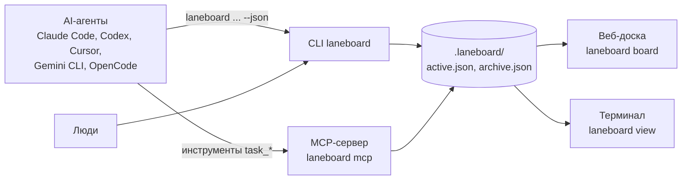

[English](https://github.com/bazarbayevabylay/laneboard/blob/main/README.md) | Русский

# laneboard

**Доска задач и CLI для AI-агентов.** Память задач для агентов и их оркестратора, которая переживает сессию:
задачи, исполнители, история и итоги лежат в папке проекта, поэтому не теряются после `/clear`, сжатия контекста и перезапуска.
Вы смотрите на них на живой локальной доске, а параллельные агенты на одной машине пишут в неё без потерь.

[](https://www.npmjs.com/package/laneboard) [](https://github.com/bazarbayevabylay/laneboard/blob/main/LICENSE) [](https://nodejs.org/)

<!-- guide:skip installs globally -->
```sh
npm i -g laneboard
```

<picture>
  <source media="(prefers-color-scheme: dark)" srcset="https://raw.githubusercontent.com/bazarbayevabylay/laneboard/main/docs/assets/board-dark.png">
  
</picture>

Работает с Claude Code, Codex, Cursor, Gemini CLI, OpenCode и любым другим MCP-клиентом.
Ни базы данных, ни аккаунта, ни сети: доска — два JSON-файла в папке проекта; веб-доска — локальный сервер, который вы запускаете сами.

## Подойдёт ли вам

- **Да, если** у вас несколько агентов работают параллельно на одной машине (сессии, субагенты, git worktree), нужен журнал, кто что
  взял и с каким итогом, и проверки, где автор не принимает свою работу, а у вашего оркестратора нет своего хранилища задач и доски.
- **Нет, если** нужна одна доска на несколько машин или в облаке, задачи должны жить в git, команда уже работает в
  Linear, GitHub Issues или Jira (laneboard с ними не синхронизируется), у вас Windows или нужны зависимости между задачами
  (в laneboard нет «blocked by» и очереди готовых задач). Рядом с альтернативами: [Сравнение](#сравнение).

## Зачем laneboard

- **Память вне контекстного окна.** Новая, сжатая или перезапущенная сессия выполняет `laneboard prime` и видит число задач
  по статусам, свои открытые задачи и свободные (в Claude Code это печатает хук при старте, после `/clear` и после сжатия контекста);
  `laneboard get <ID>` показывает историю и итог задачи.
- **Видно, кто чем занят.** По каждой задаче ясно, кто её держит, что с ней происходило и чем всё закончилось (с git-коммитом);
  доска в браузере показывает изменение через 1–2 с.
- **Надёжная параллельная запись на одной машине.** Каждая запись берёт блокировку и атомарно заменяет файл; задачу, взятую под
  одним именем, под другим взять нельзя (`ALREADY_CLAIMED`). Защита работает по имени: субагенты одной сессии Claude Code делят её имя
  по умолчанию, поэтому каждому нужен свой `--as` ([субагенты](https://github.com/bazarbayevabylay/laneboard/blob/main/docs/orchestrators.md#subagents-a-name-for-each), на английском).
- **Проверки для оркестратора.** Ревьюеры и шаги проверки по желанию; автор никогда не принимает свою работу
  ([docs/orchestrators.md](https://github.com/bazarbayevabylay/laneboard/blob/main/docs/orchestrators.md), на английском).
- **Ошибка подсказывает агенту, что делать.** В каждой ошибке есть `fix` — готовая команда: выполнить как есть или поправить под себя.

`laneboard setup` добавляет в ваш `CLAUDE.md` или `AGENTS.md` короткий блок правил (вести каждый запрос на доске), а в Claude Code —
хуки, которые печатают правила при старте сессии и напоминают агенту, если он правит файлы без задачи.

## Быстрый старт

1. Поставьте CLI, один раз на машину: `npm i -g laneboard` (Node.js 22 или новее, macOS или Linux).
2. В корне проекта создайте доску и подключите агента. Имя и описание в одну строку подскажут агентам, чья это доска.

```sh
laneboard init --name web --description "Интернет-магазин ACME: витрина и корзина"
laneboard setup claude-code
```

3. Откройте новую сессию агента в папке проекта: инструкции подгружаются при старте. В Claude Code хук печатает правила и ваши
   задачи (MCP-сервера нет, если не `setup claude-code --mcp`); другие агенты подгружают MCP-сервер `laneboard`. Проверьте доску из терминала:

```sh
laneboard prime
```

4. Дайте агенту любую задачу. Он заведёт её на доске, возьмёт в работу, будет комментировать шаги и закроет с итогом.

Другой агент? Возьмите его команду из раздела [Подключение агента](#подключение-агента). Подробнее об установке: [docs/install.md](https://github.com/bazarbayevabylay/laneboard/blob/main/docs/install.md) (на английском).

## Для AI-агентов

Вставьте это своему агенту (Claude Code, Codex, Cursor, Gemini CLI, OpenCode):

```text
Подключи laneboard к этому проекту по разделам 1 и 2 гайда
https://raw.githubusercontent.com/bazarbayevabylay/laneboard/main/docs/agent-guide.md
(поставь CLI, сделай `laneboard init` с именем и описанием этого проекта и `laneboard setup` для агента, которым ты являешься).
Потом выполни `laneboard prime`, веди эту и все следующие задачи на доске и скажи, если тебя нужно перезапустить.
```

[Гайд для агентов](https://github.com/bazarbayevabylay/laneboard/blob/main/docs/agent-guide.md) (на английском) — полное руководство
для агента: установка, цикл задачи, ошибки, настройка, импорт. Он есть и в npm-пакете: `$(npm root -g)/laneboard/docs/agent-guide.md`.

## Подключение агента

Одна команда в корне проекта: `laneboard setup claude-code` (или `codex`, `cursor`, `gemini`, `opencode`). Она добавляет блок
инструкций из трёх строк, привязывает проект к его доске и регистрирует MCP-сервер `laneboard`; Claude Code вместо него получает хуки,
а сервер — только с `--mcp` (агент там работает через CLI). `--dry-run` ничего не пишет, `--remove` убирает только то, что записал setup. Что пишет каждая команда и что коммитить, плагин Claude Code вместо setup, любой другой MCP-клиент:
[docs/configuration.md](https://github.com/bazarbayevabylay/laneboard/blob/main/docs/configuration.md) (на английском).

## Что делает агент

Эти команды агент выполняет сам (или те же MCP-инструменты `task_*`). `dev-1` — имя, которое выбирает агент. Без `--as` сессия
Claude Code подписывается как `claude-code@<вы>:<сессия>`; у остальных агентов и у вас в терминале имени по умолчанию нет (`prime`
пишет "your name is not set"), они передают `--as <любое имя>` ([docs/agent-names.md](https://github.com/bazarbayevabylay/laneboard/blob/main/docs/agent-names.md)).

```sh
laneboard create "Починить редирект после входа" --status todo --assignee dev-1 --as dev-1 --json
laneboard claim WEB-1 --status in_progress --as dev-1 --json
laneboard claim WEB-1 --as codex-1 --json  # exit 4
laneboard comment WEB-1 "Причина: редирект теряет query string" --as dev-1 --json
laneboard update WEB-1 --append-description "Шаги: войти со страницы /cart" --as dev-1 --json
laneboard finish WEB-1 --result "Исправлено, тест на редирект добавлен" --as dev-1 --json
laneboard list --scope all --json
```

В третьей строке второй агент пытается взять ту же задачу. Он получает ошибку с командой, которую нужно выполнить вместо этого (код выхода 4):

```json
{"ok": false, "store": "/path/to/project/.laneboard", "prefix": "WEB",
 "error": {"code": "ALREADY_CLAIMED",
  "message": "task WEB-1 is already claimed by dev-1; do not take it over: reassignment is the orchestrator's decision",
  "fix": "laneboard comment WEB-1 \"<note for dev-1>\" --as codex-1 --json", "details": {"assignee": "dev-1"}}}
```

`finish` записывает итог, привязывает текущий git-коммит (вне git или до первого коммита — никакого: `"commit": null`) и закрывает задачу.
Подробнее: [docs/task-cycle.md](https://github.com/bazarbayevabylay/laneboard/blob/main/docs/task-cycle.md).

## Как смотреть доску

`laneboard board` в папке проекта печатает `http://127.0.0.1:7420/` и показывает доску до Ctrl+C; порт занят (`PORT_IN_USE`):
`laneboard board --port 0` возьмёт свободный, `--port N` — заданный. Она только для просмотра
и обновляется сама: задачи меняют агенты, CLI и MCP; каждая доска машины — отдельная вкладка. Клик по задаче открывает её поля и историю.

<picture>
  <source media="(prefers-color-scheme: dark)" srcset="https://raw.githubusercontent.com/bazarbayevabylay/laneboard/main/docs/assets/task-dark.png">
  
</picture>

`laneboard view` рисует ту же доску в терминале; `view --watch` перерисовывает её после каждой записи.

```sh
laneboard view
```


Порты, фильтры и HTTP API только для чтения (токен, пример `curl`): [docs/board-http-api.md](https://github.com/bazarbayevabylay/laneboard/blob/main/docs/board-http-api.md).

## Как это устроено



Всё лежит в `.laneboard/` проекта. Каждая запись берёт блокировку, читает свежие данные, проверяет их и атомарно заменяет файл,
поэтому много агентов пишут одновременно без потерь. `init` убирает папку из git, `laneboard doctor` её проверяет.

```sh
laneboard doctor
```

Резервные копии, удаление и вычистка секретов, импорт из Markdown-файлов с frontmatter, JSON-файлов задач и чеклиста `TODO.md` (импорта и синхронизации с Linear, GitHub и Jira нет): [docs/storage.md](https://github.com/bazarbayevabylay/laneboard/blob/main/docs/storage.md).

## Сравнение

Что обычно сравнивает разработчик со своим оркестратором. Сверено с документацией каждого проекта 2026-11-07; источники и цитаты:
[docs/comparison.md](https://github.com/bazarbayevabylay/laneboard/blob/main/docs/comparison.md) (на английском). «—»: в их документации не нашли.

| | laneboard | Claude Code Tasks | beads | Backlog.md | GitHub Issues (MCP) | `TODO.md` |
|---|---|---|---|---|---|---|
| Где живут задачи | два JSON-файла в `.laneboard/` | `~/.claude/tasks/` | база Dolt в `.beads/` | Markdown-файл на задачу в репозитории | GitHub | один файл в репозитории |
| Между машинами | нет, одна машина | нет, локальная папка | да, `bd dolt push` / `pull` | да, через git | да | через git, слияние руками |
| Агенты | 5 через `setup`, любой MCP-клиент | только Claude Code | любой с shell; setup для нескольких | любой MCP- или CLI-агент | любой MCP-клиент | любой |
| Два агента, одна задача | блокировка + `ALREADY_CLAIMED`, если у каждого агента своё имя | claim с блокировкой файла в agent teams (экспериментально, выключено по умолчанию) | атомарный `bd update --claim` | — | исполнители (assignees) | правки затирают друг друга |
| Зависимости | только ссылка, ничего не блокирует | да | да, `bd ready` | да | да, «blocked by» | нет |
| Доска для вас | локальная веб-доска (только просмотр, живая), вид в терминале | чеклист в терминале | доски от сообщества | доска в терминале, редактируемая веб-доска | GitHub Projects | ваш редактор |
| Роли проверки | да, автор не принимает свою работу | хук может не дать закрыть задачу (`TaskCompleted`, agent teams); разделения «автор / проверяющий» нет | — | — | — | нет |
| Что нужно | macOS или Linux, Node.js 22 | Task-инструменты по умолчанию только на части моделей | macOS, Linux, Windows, FreeBSD | macOS, Linux, Windows | аккаунт (OAuth или токен), сеть | ничего |

## Ограничения

| Что | Почему |
|---|---|
| Только macOS и Linux | атомарный rename и блокировка проверены там; Windows нет в CI, npm отказывается ставить пакет (`EBADPLATFORM`) |
| Одна машина, локальные диски | блокировка — каталог в файловой системе: ни сетевых дисков, ни папок Dropbox или iCloud |
| До ~10 000 задач на доске | каждая команда читает файл целиком; старые задачи стоит архивировать |
| Путь доски этой машины в файлах проекта | его пишет `setup`; на другой машине запустите `setup` заново |
| Доска в браузере только для просмотра | задачи меняют агенты, CLI и MCP |

## Документация

Подробные документы — на английском.

| Что | Где |
|---|---|
| Гайд для агентов: установка, цикл задачи, ошибки, настройка, импорт | [docs/agent-guide.md](https://github.com/bazarbayevabylay/laneboard/blob/main/docs/agent-guide.md) |
| Установка из git, версии Node.js, обновление, удаление, перенос на другую машину | [docs/install.md](https://github.com/bazarbayevabylay/laneboard/blob/main/docs/install.md) |
| Что пишет setup, подробности MCP, префикс, статусы, поля, метки | [docs/configuration.md](https://github.com/bazarbayevabylay/laneboard/blob/main/docs/configuration.md) |
| Цикл задачи: создание, закрытие, подзадачи, git worktree | [docs/task-cycle.md](https://github.com/bazarbayevabylay/laneboard/blob/main/docs/task-cycle.md) |
| Имена агентов, сессии, `/clear` и продолжение работы | [docs/agent-names.md](https://github.com/bazarbayevabylay/laneboard/blob/main/docs/agent-names.md) |
| Оркестраторам: проверки в N шагов, проверяющие, авторы задач, субагенты, передача задачи | [docs/orchestrators.md](https://github.com/bazarbayevabylay/laneboard/blob/main/docs/orchestrators.md) |
| Монорепозиторий и несколько досок | [docs/monorepo.md](https://github.com/bazarbayevabylay/laneboard/blob/main/docs/monorepo.md) |
| Доска в терминале и браузере, HTTP API | [docs/board-http-api.md](https://github.com/bazarbayevabylay/laneboard/blob/main/docs/board-http-api.md) |
| Хранилище, безопасность, удаление и redact, импорт | [docs/storage.md](https://github.com/bazarbayevabylay/laneboard/blob/main/docs/storage.md) |
| laneboard рядом с Claude Code Tasks, beads, Backlog.md, GitHub Issues, `TODO.md`: источники | [docs/comparison.md](https://github.com/bazarbayevabylay/laneboard/blob/main/docs/comparison.md) |
| Что изменилось в каждой версии | [CHANGELOG.md](https://github.com/bazarbayevabylay/laneboard/blob/main/CHANGELOG.md) |
| Архитектурное решение и спецификация | [ADR-0001](https://github.com/bazarbayevabylay/laneboard/blob/main/docs/adr/0001-two-json-store-cli-first.md) |

Каждый блок `sh` этого файла и документов выполняется в тестах laneboard по порядку, в новом проекте: команды и коды выхода настоящие.

## Лицензия

MIT, см. [LICENSE](https://github.com/bazarbayevabylay/laneboard/blob/main/LICENSE).
