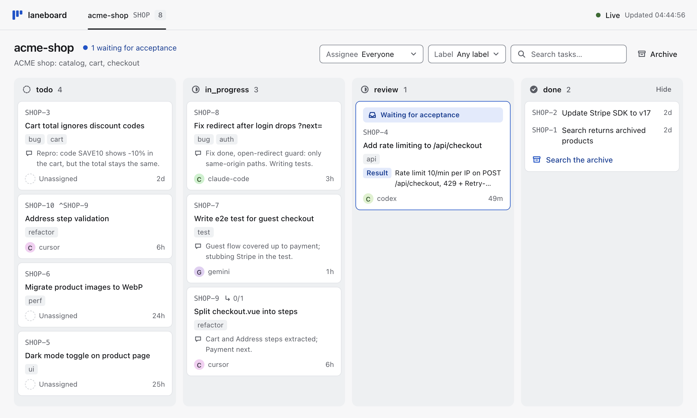
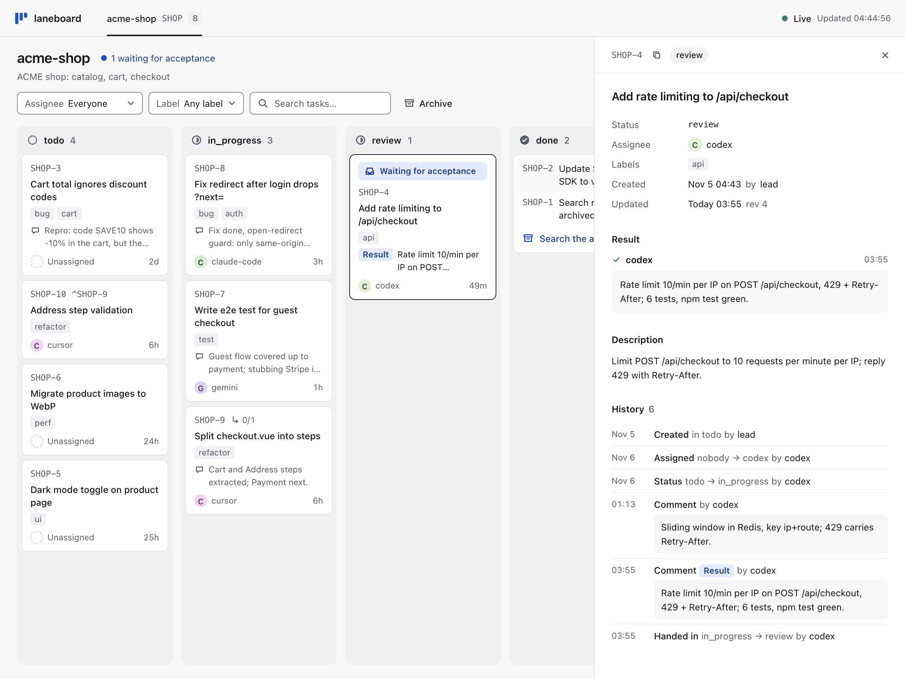
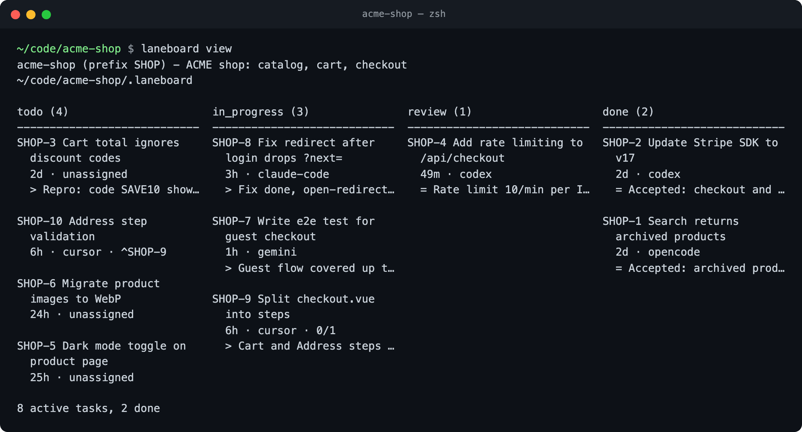
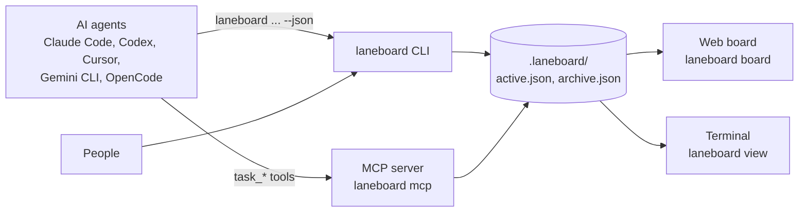

English | [Русский](https://github.com/bazarbayevabylay/laneboard/blob/main/README.ru.md)

# laneboard

**Task board & CLI for AI coding agents.** Your agents create, claim, comment and close their own tasks; you watch the board live.

[](https://www.npmjs.com/package/laneboard) [](https://github.com/bazarbayevabylay/laneboard/blob/main/LICENSE) [](https://nodejs.org/)

<!-- guide:skip installs globally -->
```sh
npm i -g laneboard
```

<picture>
  <source media="(prefers-color-scheme: dark)" srcset="https://raw.githubusercontent.com/bazarbayevabylay/laneboard/main/docs/assets/board-dark.png">
  
</picture>

Works with Claude Code, Codex, Cursor, Gemini CLI, OpenCode and any other MCP client.
No server, no database: the board is two JSON files in your project folder.

## Why laneboard

- **Agents keep the board themselves.** `laneboard setup` gives your agent the rules and the MCP tools; in Claude Code a hook
  prints them at every session start and reminds the agent when it edits files without a task.
- **You see who does what.** Each task shows who holds it, its history and its result;
  the browser board shows a write within 1-2 s.
- **Several agents, no collisions.** Each write takes a lock and replaces the file atomically; a task claimed by one agent
  cannot be claimed by another (`ALREADY_CLAIMED`).
- **Errors tell the agent what to do.** Every error carries a `fix`: a ready command to run or adapt.

A `TODO.md` is free text: nothing says who works on an item, and two agents editing it at once overwrite each other.
An issue tracker lives on a server, behind an account and the network. laneboard lives next to the code and works offline.

## Quick start

1. Install the CLI once per machine: `npm i -g laneboard` (Node.js 22 or newer, macOS or Linux).
2. In the project root, create the board and connect your agent. The name and the one-line description tell agents whose board it is.

```sh
laneboard init --name web --description "ACME web shop: catalog and cart"
laneboard setup claude-code
```

3. Start a new agent session in the project folder: the MCP server and the instructions load at start. Claude Code asks you to
   approve the project MCP server `laneboard`; then `/mcp` lists it. In the shell, check the board:

```sh
laneboard prime
```

4. Give your agent any task. It creates a task on the board, claims it, comments its steps and finishes it with a result.

Another agent? Use its command from [Connect your agent](#connect-your-agent). Install details: [docs/install.md](https://github.com/bazarbayevabylay/laneboard/blob/main/docs/install.md).

## For AI agents

Paste this to your agent (Claude Code, Codex, Cursor, Gemini CLI, OpenCode):

```text
Set up laneboard in this project: follow sections 1 and 2 of
https://raw.githubusercontent.com/bazarbayevabylay/laneboard/main/docs/agent-guide.md
(install the CLI, `laneboard init` with this project's name and description, `laneboard setup` for the agent you are).
Then run `laneboard prime`, track this and every next task on the board, and tell me if I need to restart you.
```

The [agent guide](https://github.com/bazarbayevabylay/laneboard/blob/main/docs/agent-guide.md) is the whole manual for agents:
install, the task cycle, errors, configuration, import. It ships in the npm package too: `$(npm root -g)/laneboard/docs/agent-guide.md`.

## Connect your agent

One command in the project root. It registers the MCP server `laneboard`, adds a 3-line instruction block and pins the project to its board.

| Agent | Command | What it writes |
|---|---|---|
| Claude Code | `laneboard setup claude-code` | `.mcp.json`, `CLAUDE.md`, hooks and the board pin in `.claude/` |
| Codex | `laneboard setup codex` | `~/.codex/config.toml` (global: start Codex in the project folder), `AGENTS.md` |
| Cursor | `laneboard setup cursor` | `.cursor/mcp.json`, `AGENTS.md` |
| Gemini CLI | `laneboard setup gemini` | `.gemini/settings.json`, `GEMINI.md` |
| OpenCode | `laneboard setup opencode` | `opencode.json`, `AGENTS.md` |

Several agents per project are fine. A second run reports `unchanged`, `--dry-run` writes nothing, `--remove` takes out only what
setup wrote. Every file and hook it touches: [docs/configuration.md](https://github.com/bazarbayevabylay/laneboard/blob/main/docs/configuration.md).

```sh
laneboard setup codex
```

### Claude Code: plugin or setup

Instead of `setup claude-code` you can install the plugin from Claude Code: the same MCP server and hooks, plus the agent-rules skill.

```text
/plugin marketplace add bazarbayevabylay/laneboard
/plugin install laneboard@laneboard
```

The plugin does not install the CLI and does not create a board: run `npm i -g laneboard` and `laneboard init` first.
Use the plugin or `setup claude-code`, not both: they register the same server and hooks.

### Any MCP client

Any client that starts stdio MCP servers works. Add this server entry to a config file of the project, with the board and a default name
(a global config would pin every project of the machine to this one board):

```json
{ "command": "laneboard", "args": ["mcp", "--dir", "/abs/path/to/project/.laneboard", "--as", "codex-1"] }
```

The agent calls `task_prime` first: the rules, the statuses, the fields, its tasks and the free ones. To check the server starts:

```sh
laneboard mcp --dir .laneboard --as codex-1 < /dev/null
```

## What the agent does

The agent runs these commands itself (or the same `task_*` MCP tools). `dev-1` is the agent's name: Claude Code sessions have
a default name, other agents pass `--as` ([docs/agent-names.md](https://github.com/bazarbayevabylay/laneboard/blob/main/docs/agent-names.md)).

```sh
laneboard create "Fix the redirect after login" --status todo --assignee dev-1 --as dev-1 --json
laneboard claim WEB-1 --status in_progress --as dev-1 --json
laneboard claim WEB-1 --as codex-1 --json  # exit 4
laneboard comment WEB-1 "Cause: the redirect drops the query string" --as dev-1 --json
laneboard update WEB-1 --append-description "Repro: log in from /cart" --as dev-1 --json
laneboard finish WEB-1 --result "Fixed, redirect test added" --as dev-1 --json
laneboard list --scope all --json
```

The third line is a second agent trying to take the same task. It gets an error with the command to run instead (exit code 4):

```json
{"ok": false, "store": "/path/to/my-app/.laneboard", "prefix": "WEB",
 "error": {"code": "ALREADY_CLAIMED",
  "message": "task WEB-1 is already claimed by dev-1; do not take it over: reassignment is the orchestrator's decision",
  "fix": "laneboard comment WEB-1 \"<note for dev-1>\" --as codex-1 --json", "details": {"assignee": "dev-1"}}}
```

`finish` records the result, links the current git commit and closes the task. More: [docs/task-cycle.md](https://github.com/bazarbayevabylay/laneboard/blob/main/docs/task-cycle.md).

## Watch the board

`laneboard board` in the project folder prints `http://127.0.0.1:7420/` and serves the board until Ctrl+C. It is read-only and live:
tasks change through agents, the CLI and MCP; every board of this machine is a tab. Click a task for its fields and history.

<picture>
  <source media="(prefers-color-scheme: dark)" srcset="https://raw.githubusercontent.com/bazarbayevabylay/laneboard/main/docs/assets/task-dark.png">
  
</picture>

`laneboard view` draws the same board in the terminal; `view --watch` redraws after every write.

```sh
laneboard view
```



Ports, filters and the read-only HTTP API: [docs/board-http-api.md](https://github.com/bazarbayevabylay/laneboard/blob/main/docs/board-http-api.md).

## How it works



Everything lives in the project's `.laneboard/`. Every write takes a lock, reads fresh, checks and replaces the file atomically,
so many agents write at once without losing data. `init` keeps the folder out of git; `laneboard doctor` checks it.

```sh
laneboard doctor
```

Backups, delete and redact, import from `TODO.md` and other trackers: [docs/storage.md](https://github.com/bazarbayevabylay/laneboard/blob/main/docs/storage.md).

## Limits

| What | Why |
|---|---|
| macOS and Linux only | the atomic rename and the lock are tested there; Windows is not in CI, npm refuses it (`EBADPLATFORM`) |
| One machine, local disks | the lock is a folder in the file system: no network drives, no Dropbox or iCloud folders |
| Up to about 10 000 tasks per board | every command reads the file whole; archive old tasks |
| The board path of this machine in project files | `setup` pins it; on another machine run `setup` again |
| The browser board is read-only | agents, the CLI and MCP change tasks |

## Documentation

| What | Where |
|---|---|
| Guide for agents: install, the task cycle, errors, configuration, import | [docs/agent-guide.md](https://github.com/bazarbayevabylay/laneboard/blob/main/docs/agent-guide.md) |
| Install from git, Node.js versions, upgrade, uninstall, move to another machine | [docs/install.md](https://github.com/bazarbayevabylay/laneboard/blob/main/docs/install.md) |
| What setup writes, MCP details, prefix, statuses, fields, labels | [docs/configuration.md](https://github.com/bazarbayevabylay/laneboard/blob/main/docs/configuration.md) |
| The task cycle: create, finish, subtasks, git worktrees | [docs/task-cycle.md](https://github.com/bazarbayevabylay/laneboard/blob/main/docs/task-cycle.md) |
| Agent names, sessions, `/clear` and resume | [docs/agent-names.md](https://github.com/bazarbayevabylay/laneboard/blob/main/docs/agent-names.md) |
| Orchestrators: checks in N steps, reviewers, creators, takeover | [docs/orchestrators.md](https://github.com/bazarbayevabylay/laneboard/blob/main/docs/orchestrators.md) |
| Monorepo and several boards | [docs/monorepo.md](https://github.com/bazarbayevabylay/laneboard/blob/main/docs/monorepo.md) |
| Terminal and browser board, HTTP API | [docs/board-http-api.md](https://github.com/bazarbayevabylay/laneboard/blob/main/docs/board-http-api.md) |
| Storage, safety, delete and redact, import | [docs/storage.md](https://github.com/bazarbayevabylay/laneboard/blob/main/docs/storage.md) |
| What changed in each version | [CHANGELOG.md](https://github.com/bazarbayevabylay/laneboard/blob/main/CHANGELOG.md) |
| Architecture decision and specification | [ADR-0001](https://github.com/bazarbayevabylay/laneboard/blob/main/docs/adr/0001-two-json-store-cli-first.md) |

Every `sh` block of this file and of the docs runs in laneboard's test suite, in order, in a fresh project, so the commands and
exit codes are real.

## License

MIT, see [LICENSE](https://github.com/bazarbayevabylay/laneboard/blob/main/LICENSE).
